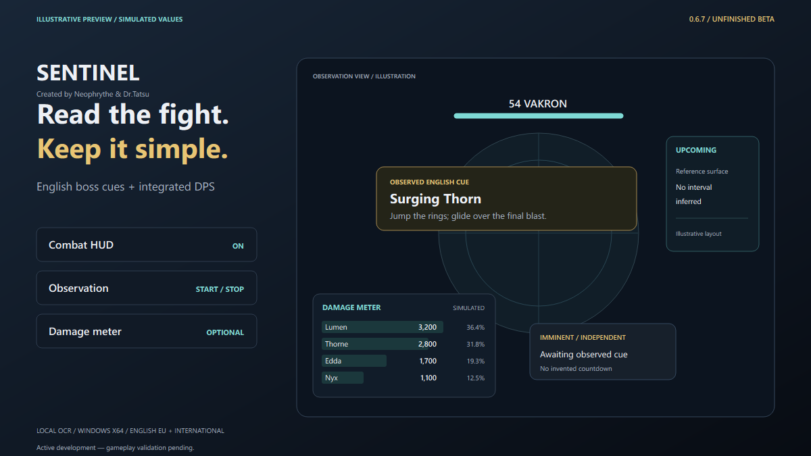

# AION 2 Sentinel — Boss Helper & Damage Meter

**Active development — gameplay validation pending.**

**Automatic encounter selection. Clear boss warnings. Optional damage analysis.**

Created by **Neophrythe & Dr.Tatsu**. GitHub maintainer: [neophrythe](https://github.com/neophrythe). Windows x64 · AION 2 EU / International · English client.

[Download 0.6.13 — Unfinished Beta](https://github.com/neophrythe/Aion-2-Sentinel-DBM-and-Damage-Meter-/releases/tag/v0.6.13) · [Presentation](https://neophrythe.github.io/Aion-2-Sentinel-DBM-and-Damage-Meter-/) · [Quick start](guides/QUICK_START.md) · [Report a problem](https://github.com/neophrythe/Aion-2-Sentinel-DBM-and-Damage-Meter-/issues/new/choose)

*Illustrative preview with simulated cues and damage. This is promotional artwork, not a gameplay capture.*

## New in 0.6.13

DPS now uses a shared first-to-last hit interval with a one-second minimum. Recognised unresolved summon damage is retained and can be merged later with generation-scoped ownership. Compact damage ticks, bounded nested packets and NPC self-heal filtering are improved. Boss-only and all-target scopes are labelled clearly. Deus recognition, capture continuity, automatic boss attempts and bounded history improvements are included. 182 Python checks and 88 native worker assertions passed on this build. Complete frozen-application gameplay and the reported live DPS difference still require a matching encounter comparison.

## Measured cast-end estimates

Visible remaining seconds or a changing target-cast bar can supply a **cast (est.)** countdown and an estimated cast-ending heads-up. Sentinel requires fresh, consistent independent measurements; a skill name alone never starts a clock. Missing, hidden or ambiguous cast evidence can leave the countdown absent.

Expert Cues, the boss library and GameData expose timing metadata for **550 accepted skill IDs across 209 profiles**. The expert **Cast-end heads-up (s)** setting defaults to 3 seconds and accepts 0–30 seconds. Raw casting/cooldown values remain reference data; they do not establish seconds, recurring fight schedules or individual wave impacts. No extra beginner control is required. See [cast timing and limits](docs/CAST_TIMING.md).

## Three controls

- **Combat HUD** — show or hide boss warnings.
- **Start / Stop observation** — observe the visible English game HUD. Names, levels, locations, compatible profiles and standard HUD regions are selected automatically.
- **Damage meter** — enable or disable the integrated capture worker and its independent damage overlay. Capture adapters are selected automatically.

Normal enemies stay quiet. Advanced configuration, the boss library, recording tools and detailed meter controls are available through **Advanced → Expert controls**. Stopping observation leaves the optional meter running.

## Install

1. Download `AION-Sentinel-0.6.13-beta-windows-x64.7z` from the release page.
2. Extract the **complete archive** into a writable folder. Keep `_internal`, `meter` and the supplied notices beside the executable.
3. Open `AION-Sentinel.exe` or `Start-AION-Sentinel.cmd` inside that folder.
4. Start observation and bring the English AION2 window to the foreground. Turn on Damage meter if wanted.

Python and an online service account are not required for the packaged OCR observer. Live damage capture requires a separate [Npcap installation](https://npcap.com/#download) and sufficient capture permissions. If Npcap is absent, enabling **Damage meter** offers guided setup for the fixed **Npcap 1.89** installer. With your consent, Sentinel downloads it from the official publisher, checks the pinned SHA-256 and publisher signature, then opens the normal visible installer and Windows elevation prompt. You review the license and choose installation options yourself. The driver and installer are not bundled; installation is not silent.

An existing Npcap installation skips setup. Cancelling, declining elevation or installation failure leaves the meter off while screen OCR remains available. If a reboot is required, Sentinel leaves capture off and does not restart Windows. Otherwise, it rechecks capture components and retries the worker. See the [guided meter setup](docs/DAMAGE_METER.md).

**F7** toggles the combat HUD · **F8** starts/stops observation · **F9** resets the encounter. F10 remains available to the game.

## 0.6.13 status

**0.6.13 — Unfinished Beta.** Active development with partial boss-mechanic coverage. Gameplay validation is pending; focused offline checks, compilation and package integrity have been checked.

The 0.6.13 7z archive is **95,533,011 bytes (95.53 MB / 91.11 MiB)** with **442 extracted files**, below the strict **100,000,000-byte** limit. SHA-256: `b90481196a5d8e6b045d80c8a33db459127f9c3d5082536e31c74d8e3a472961`. See the [0.6.13 release notes](releases/v0.6.13/README.md).

| Reviewed source inventory | Coverage |
| --- | --- |
| Encounter identity profiles | 1,002 |
| New sourced mechanic references | 88 |
| Profiles associated with new mechanic references | 42 |
| World-boss list | 54 entries / 51 distinct profiles |
| Source instance-map variants with explicit entrance GS ≥1,400 | 83 |
| Combined world / high-GS target profiles | 137; 72 have some warning support, 65 remain identity-only |

These counts describe the reviewed source inventory. They do not establish complete mechanics, current content availability or live recognition for every boss. Twenty-five world profiles have no actionable owned skill label beyond ordinary Attack. Basic Attack is excluded from generated warnings.

## How it works

Boss warnings use local screen OCR and reviewed encounter rules. Generated skill warnings require two distinct observations of a complete English cue. Published responses are linked only to an already owned local NPC skill label. Source HP hints remain unverified references.

When difficulty is unknown, Sentinel can use identical enabled skill warnings shared by all compatible variants. Variant HP hints and timers wait for sufficient evidence. Hidden HUD labels, unresolved locations and ambiguous normal/summon variants can pause warnings. No boss timings are invented.

The optional meter observes captured combat records through the bundled native worker. Player names appear when matching identity records arrive; keep capture enabled during login or an area change if names are pending. Automatic boss attempts count that boss only; All targets retains the independent counter, including adds. Non-party actors can be present unless confirmed-party filtering is enabled. Live EU accuracy is unverified.

Sentinel runs alongside the game. It does not inject into AION2, modify game files or automate gameplay. Internal package signatures are separate from Windows Authenticode publisher signing.

## Documentation and support

- [Quick start](guides/QUICK_START.md)
- [Detailed beginner controls](docs/BEGINNER_MODE.md)
- [Damage-meter setup and measurements](docs/DAMAGE_METER.md)
- [Measured cast estimates and timing limits](docs/CAST_TIMING.md)
- [Complete user guide](docs/USER_GUIDE.md)
- [FAQ and troubleshooting](guides/FAQ.md)
- [Coverage and validation status](guides/COVERAGE.md)
- [Release history](CHANGELOG.md)
- [Distribution and third-party notices](DISTRIBUTION.md)
- [Security reporting](SECURITY.md)

Use repository Issues for support and feature requests. This repository hosts release information, documentation and marketing material; Sentinel's implementation source and private build material are not published here. AION and AION2 belong to their respective owners. Sentinel is independent of NCSOFT and Deadly Boss Mods; official approval and account-safety guarantees have not been established.
