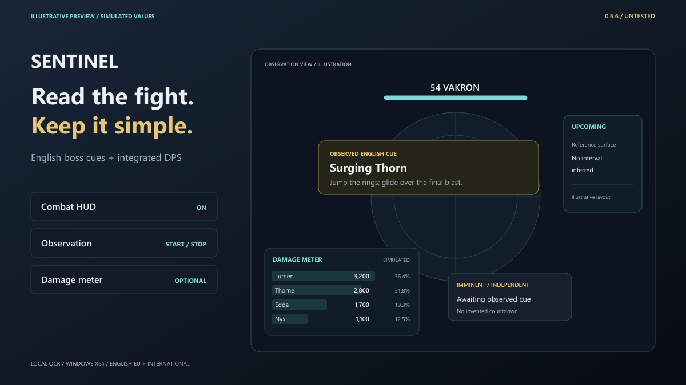

# AION 2 Sentinel — Boss Helper & Damage Meter

**Automatic encounter selection. Clear boss warnings. Optional damage analysis.**

Maintained by [neophrythe](https://github.com/neophrythe). Windows x64 · AION 2 EU / International · English client.

[Download 0.6.6](https://github.com/neophrythe/Aion-2-Sentinel-DBM-and-Damage-Meter-/releases/tag/v0.6.6) · [Presentation](https://neophrythe.github.io/Aion-2-Sentinel-DBM-and-Damage-Meter-/) · [Quick start](guides/QUICK_START.md) · [Report a problem](https://github.com/neophrythe/Aion-2-Sentinel-DBM-and-Damage-Meter-/issues/new/choose)

*Illustrative preview with simulated cues and damage. This is promotional artwork, not a gameplay capture.*

## Three controls

- **Combat HUD** — show or hide boss warnings.
- **Start / Stop observation** — observe the visible English game HUD. Names, levels, locations, compatible profiles and standard HUD regions are selected automatically.
- **Damage meter** — enable or disable the integrated capture worker and its independent damage overlay. Capture adapters are selected automatically.

Normal enemies stay quiet. Advanced configuration, the boss library, recording tools and detailed meter controls are available through **Advanced → Expert controls**. Stopping observation leaves the optional meter running.

## Install

1. Download `AION-Sentinel-0.6.6-untested-windows-x64.7z` from the release page.
2. Extract the **complete archive** into a writable folder. Keep `_internal`, `meter` and the supplied notices beside the executable.
3. Open `AION-Sentinel.exe` or `Start-AION-Sentinel.cmd` inside that folder.
4. Start observation and bring the English AION2 window to the foreground. Turn on Damage meter if wanted.

Python and an online service account are not required for the packaged OCR observer. Live damage capture requires [Npcap installed separately](https://npcap.com/#download) and sufficient capture permissions. The driver is not bundled.

**F7** toggles the combat HUD · **F8** starts/stops observation · **F9** resets the encounter. F10 remains available to the game.

## 0.6.6 status

**Untested implementation preview.** No new functional, unit, integration, executable, OCR, UI or live-game tests were run for this build. Compilation and signed-file/archive integrity checks do not establish gameplay behavior.

| Reviewed source inventory | Coverage |
| --- | --- |
| Encounter identity profiles | 1,002 |
| Profiles with some skill-text or HP warning support | 223 |
| Profiles with identity metadata only | 779 |
| World-boss list | 54 entries / 51 distinct profiles |
| Source instance-map variants with explicit entrance GS ≥1,400 | 83 |
| Combined world / high-GS target profiles | 137; 72 have some warning support, 65 remain identity-only |

These counts describe the reviewed source inventory. They do not establish complete mechanics, current content availability or live recognition for every boss. Twenty-five world profiles have no actionable owned skill label beyond ordinary Attack. Basic Attack is excluded from generated warnings.

## How it works

Boss warnings use local screen OCR and reviewed encounter rules. Generated skill warnings require two distinct observations of a complete English cue. Published responses are linked only to an already owned local NPC skill label. Source HP hints remain unverified references.

When difficulty is unknown, Sentinel can use identical enabled skill warnings shared by all compatible variants. Variant HP hints and timers wait for sufficient evidence. Hidden HUD labels, unresolved locations and ambiguous normal/summon variants can pause warnings. No boss timings are invented.

The optional meter observes captured combat records through the bundled native worker. Player names appear when matching identity records arrive; keep capture enabled during login or an area change if names are pending. Readings can include non-party actors and aggregate several targets. Live EU accuracy is unverified.

Sentinel runs alongside the game. It does not inject into AION2, modify game files or automate gameplay. Internal package signatures are separate from Windows Authenticode publisher signing.

## Documentation and support

- [Quick start](guides/QUICK_START.md)
- [FAQ and troubleshooting](guides/FAQ.md)
- [Coverage and validation status](guides/COVERAGE.md)
- [Release history](CHANGELOG.md)
- [Distribution and third-party notices](DISTRIBUTION.md)
- [Security reporting](SECURITY.md)

Use repository Issues for support and feature requests. This repository hosts release information, documentation and marketing material; Sentinel's implementation source and private build material are not published here. AION and AION2 belong to their respective owners; this is an independent project.
